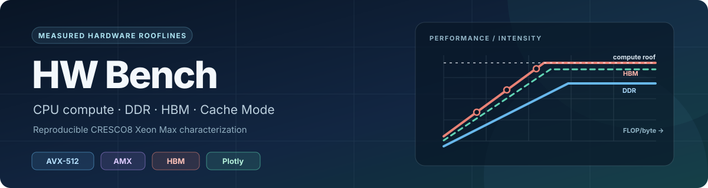

[](https://www.python.org/)
[](https://en.cppreference.com/w/c)
[](https://jupyter.org/)
[](https://plotly.com/python/)
[](https://pytest.org/)

Reproducible hardware characterization of Intel Xeon CPU Max 9480 nodes on CRESCO8: two sockets × 56 cores, SMT off, 64 GiB HBM2e and 8-channel DDR5-4800 per socket. The primary result is a **measured roofline** for Flat and Cache memory modes, for FP64, FP32, BF16 and INT8, on one and two sockets, with achieved library GEMMs at representative projection shapes placed on it.

Read the executed notebooks in order ([index](notebooks/README.md)):

0. [Master analysis](notebooks/00_master_analysis.ipynb): findings only
1. [Platform and methodology](notebooks/01_platform_and_methodology.ipynb)
2. [Memory hierarchy and bandwidth](notebooks/02_memory_hierarchy_and_bandwidth.ipynb)
3. [NUMA and socket scaling](notebooks/03_numa_and_socket_scaling.ipynb)
4. [Compute throughput](notebooks/04_compute_throughput.ipynb)
5. [Roofline atlas](notebooks/05_roofline_atlas.ipynb)

Every figure cell displays an interactive Plotly figure and saves **SVG and PNG** copies under `figures/<notebook-stem>/`. Numerical exports of the October thesis selection are under `data/processed/thesis/`.

## What is measured

| Quantity | Kernel |
| --- | --- |
| Compute peaks | AVX-512 FP64/FP32 FMA, AVX-512 BF16 `vdpbf16ps`, AVX-512 VNNI `vpdpbusd`, AMX BF16 `tdpbf16ps`, AMX INT8 `tdpbssd`; instruction use checked in an innermost loop of the binary's disassembly; effective clock and AMX-busy cycles from per-thread `perf_event_open` |
| Memory bandwidth | Triad, non-temporal-store Triad, read-only; local/remote; core scaling; Cache working-set capacity |
| Memory hierarchy | read bandwidth and dependent-load latency from 16 KiB to 4 GiB per core; one core and 56 cores |
| Achieved GEMM | oneDNN BF16 and INT8 (verified on AMX) at Llama-3.1-8B projection shapes, batch 1–4096, weights streamed from memory |
| Sockets | two timed processes over a shared window; one 112-thread process with interleaved or first-touch placement |
| Intensity sweep | FP64, K = 1…256 |

## Execution rules

Flat-mode campaigns run on **one dedicated node, over SSH, outside Slurm**, with an idle check before and a job/load watch around every record. Cache-mode campaigns run only in **exclusive Slurm allocations on other nodes**; the versioned submission template excludes the Flat node and a test fails if that exclusion is ever removed. See [Run and retrieve](docs/02_RUN_AND_RETRIEVE.md). Site values live in a private environment file outside the repository.

## Reproduce locally

```bash
python3 -m venv .venv
.venv/bin/python -m pip install -r requirements.txt
.venv/bin/python -m pytest -q
bash scripts/make_analysis.sh
```

Analysis needs Python 3.11 or newer (`tomllib`); the cluster-side scripts run on the system Python 3.9. Raw campaigns must first be present under `data/raw/cache/` and `data/raw/flat/`; the selected campaign IDs are pinned in `configs/analysis.json` (`primary_campaigns`, `benchmark_campaigns`, `supersede` for the October thesis selection; `extended_campaigns` for the later parts). No SSH connection is needed for analysis. Static export requires Kaleido and a compatible Chrome/Chromium.

## Evidence and interpretation

Raw measurements remain unchanged. Normalization retains each sample's source, campaign, node, launch method, socket, placement, implementation, shape, timing window, effective clock and acceptance decision. The analysis selects declared campaigns and accepted steady samples; it never silently chooses the best socket or latest run.

Flat DDR/HBM rates use explicit placement. Cache rates describe the effective memory system at a stated working set. Bandwidth and intensity use modeled bytes, not memory-controller counts (uncore counters are not readable without privileges). Theoretical peaks are in [`configs/theory.toml`](configs/theory.toml) with their source and whether they are vendor figures or derivations; measured peaks, theoretical peaks and library-achieved rates are always distinguished by line style.

## Documentation

- [Scope and topology](docs/01_SCOPE_AND_TOPOLOGY.md)
- [Run and retrieve](docs/02_RUN_AND_RETRIEVE.md)
- [Methods and data](docs/03_METHODS_AND_DATA.md)
- [Analysis guide](docs/04_ANALYSIS_AND_RESULTS.md)
- [Validation and preserved attempts](docs/VALIDATION.md)

Architectural references are kept separate from measurements: [Intel Max overview](https://www.intel.com/content/www/us/en/developer/articles/technical/xeon-scalable-processor-max-series.html), [9480 specifications](https://www.intel.com/content/www/us/en/products/sku/232592/intel-xeon-cpu-max-9480-processor-112-5m-cache-1-90-ghz/specifications.html), and [configuration guide](https://cdrdv2-public.intel.com/782255/354227-intel-xeon-cpu-max-series-configuration-and-tuning-guide-1.pdf).
