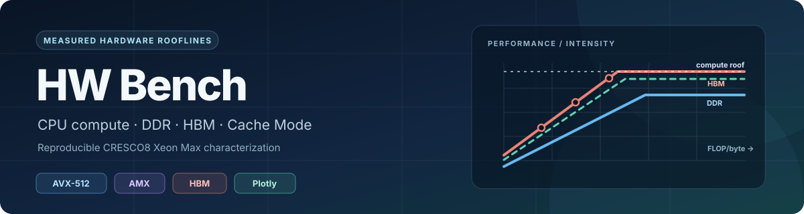

[](https://www.python.org/)
[](https://en.cppreference.com/w/c)
[](https://jupyter.org/)
[](https://plotly.com/python/)
[](https://pytest.org/)

Hardware characterization of Intel Xeon CPU Max 9480 on CRESCO8. The [final research summary](docs/FINAL_RESEARCH_SUMMARY.md) gives the thesis findings, and the [evidence matrix](docs/SCIENTIFIC_CLAIMS.md) links each claim to its campaigns. The [figure and table selection](docs/THESIS_FIGURES_AND_TABLES.md) is reproduced by the master notebook.

The supporting notebooks cover the full experimental record.

0. [Master analysis](notebooks/00_master_analysis.ipynb): findings only
1. [Platform and methodology](notebooks/01_platform_and_methodology.ipynb)
2. [Memory hierarchy and bandwidth](notebooks/02_memory_hierarchy_and_bandwidth.ipynb)
3. [NUMA and socket scaling](notebooks/03_numa_and_socket_scaling.ipynb)
4. [Compute throughput](notebooks/04_compute_throughput.ipynb)
5. [Roofline atlas](notebooks/05_roofline_atlas.ipynb)
6. [Memory controllers, power and clocks](notebooks/06_uncore_power_and_clocks.ipynb)
7. [Bandwidth configuration for inference](notebooks/07_bandwidth_configuration.ipynb): completed November core-split, placement and capacity search

Every figure cell displays an interactive Plotly figure and saves **SVG and PNG** copies under `figures/<notebook-stem>/`. Principal numerical exports and the historical October tables are under `data/processed/thesis/`.

## What is measured

| Quantity | Kernel |
| --- | --- |
| Compute peaks | AVX-512 FP64/FP32 FMA, AVX-512 BF16 `vdpbf16ps`, AVX-512 VNNI `vpdpbusd`, AMX BF16 `tdpbf16ps`, AMX INT8 `tdpbssd`; instruction use checked in an innermost loop of the binary's disassembly; effective clock and AMX-busy cycles from per-thread `perf_event_open` |
| Memory bandwidth | Triad, non-temporal-store Triad, read-only; local/remote; core scaling; Cache working-set capacity |
| Memory hierarchy | read bandwidth and dependent-load latency from 16 KiB to 4 GiB per core; one core and 56 cores |
| Achieved GEMM | oneDNN BF16 and INT8 (verified on AMX) at Llama-3.1-8B projection shapes, batch 1–4096, weights streamed from memory |
| Sockets | two timed processes over a shared window; one 112-thread process with interleaved or first-touch placement |
| Intensity sweep | FP64, K = 1…256 |

## Execution rules

The new [bandwidth configuration study](docs/BANDWIDTH_CONFIGURATION_STUDY.md) uses
exclusive Slurm allocations for its Flat-mode search. The following describes the
legacy campaigns and their recorded execution methods.

Flat-mode campaigns run on **one dedicated node, over SSH, outside Slurm**, with an idle check before and a job/load watch around every record. Cache-mode campaigns run only in **exclusive Slurm allocations on other nodes**; the versioned submission template excludes the Flat node and a test fails if that exclusion is ever removed. See [Run and retrieve](docs/02_RUN_AND_RETRIEVE.md). Site values live in a private environment file outside the repository.

## Reproduce locally

```bash
python3 -m venv .venv
.venv/bin/python -m pip install -r requirements.txt
.venv/bin/python -m pytest -q
bash scripts/make_analysis.sh
```

Analysis needs Python 3.11 or newer (`tomllib`); the cluster-side scripts run on the system Python 3.9. The build reads local archives in `data/raw/`, including the separate STREAMGAP and November study campaigns. The selected campaign IDs are pinned in `configs/analysis.json` (`primary_campaigns`, `benchmark_campaigns`, `supersede` for the October thesis selection; `extended_campaigns` for the later parts, `uncore_campaigns` for the privileged-counter parts and `data_pattern_campaign` for STREAMGAP E6). Notebook 07 uses `configs/bandwidth_search.json`. No SSH connection is needed for analysis. Static export requires Kaleido and a compatible Chrome/Chromium.

## Evidence and interpretation

Raw measurements remain unchanged. Normalization retains each sample's source, campaign, node, launch method, socket, placement, implementation, shape, timing window, effective clock and acceptance decision. The analysis selects declared campaigns and accepted steady samples; it never silently chooses the best socket or latest run.

Flat DDR/HBM rates use explicit placement. Cache rates describe the effective memory system at a stated working set. The principal Rooflines use Flat controller traffic. The matched Cache atlas reports lookup traffic from the base controller events, with DDR fills tracked separately. The theory configuration records per-cycle, SKU and vendor reference values with their sources. [Methods and data](docs/03_METHODS_AND_DATA.md)

## Documentation

- [Scope and topology](docs/01_SCOPE_AND_TOPOLOGY.md)
- [Run and retrieve](docs/02_RUN_AND_RETRIEVE.md)
- [Methods and data](docs/03_METHODS_AND_DATA.md)
- [Analysis guide](docs/04_ANALYSIS_AND_RESULTS.md)
- [Validation and preserved attempts](docs/VALIDATION.md)

Architectural references are kept separate from measurements: [Intel Max overview](https://www.intel.com/content/www/us/en/developer/articles/technical/xeon-scalable-processor-max-series.html), [9480 specifications](https://www.intel.com/content/www/us/en/products/sku/232592/intel-xeon-cpu-max-9480-processor-112-5m-cache-1-90-ghz/specifications.html), and [configuration guide](https://cdrdv2-public.intel.com/782255/354227-intel-xeon-cpu-max-series-configuration-and-tuning-guide-1.pdf).
